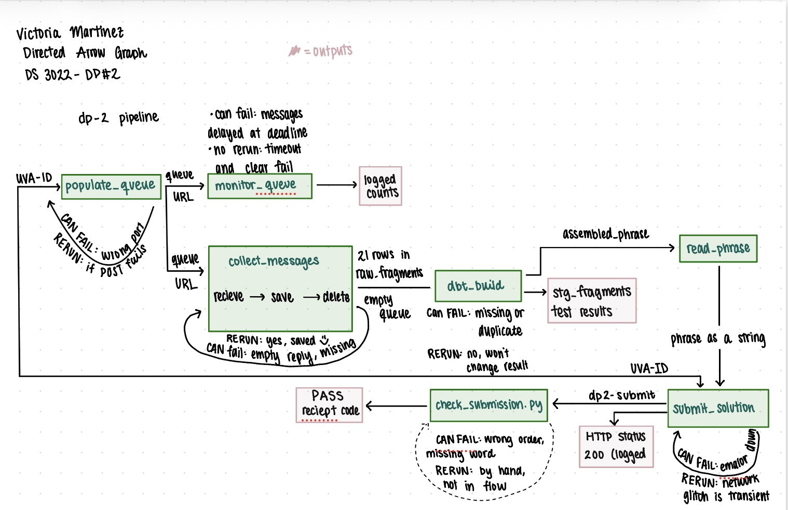

# DS 3022 - Project #2
### Victoria Martinez - October 19 - UVA id: yqg3zy 
### Submission README that explains my pipeline 

Prefect flow 'dp2-pipeline' in prefect-flow.py populates my SQS queue, collects the 21 delayed fragements (differing in the length of the delay between messages), lands them in DuckDB ('raw_fragements), runs 'dbt build' as a quality gate and then submits the assembled phrase to "dp2-submit' only if dbt passes. 

My pipeline: 

'''
populate_queue -> monitor_queue -> collect_messages -> dbt_build -> read_phrase -> submit_solution
'''

## How I setup and ran: 
1. Followed the SETUP.md to set up the venv and requirements: `python -m venv .venv && source .venv/bin/activate && pip install -r requirements.txt`
2. Set up the .env and added my 'UVA_ID' 
3. Followed the SETUP.md for the four terminals (SQS emulator, scatter API, Prefect server, working terminal)
4. Made sure that `python kit/smoke_test.py` prints `Emulator OK` (when I worked on this part over break, i had a lot of issues getting the setup to work but once I figured out the flow, it was easier to finish up the project.)
5. Tested the submission from the **repo root**: `python prefect-flow.py`, then `python kit/check_submission.py`.

### Environment Variables: 
`UVA_ID`, `SCATTER_PORT` (default 8000), `DP2_DUCKDB` (default `dp2.duckdb`),
`DP2_FAST` (1 = 5-60 s delays, 0 = 30-900 s).

## My polling strategy: 
### Tasks in 'prefect-flow.py' 
1. 'monitor_queue': polls every 5 secs and logs the visible/not visible/delayed messages.  
2. 'collect_messages': 
3. FINISH WRITING FOR THE OTHER TASKS THAT I STILL HAVE

### Receive -> persist -> delete: 
For each of the messages, (1) read 'order_no' and 'word' from 'MessageAttributes' (2) INSERT into 'raw.fragements, and then (3) 'delete_message'. If the message crashes between the save/insert step and the delete step (steps 2 and 3), the message reappears after the visibility timeout and is a "repeat delivery". This means that the code skips the insert (same order_no and word) but still deletes it. But, if it crashes before the insert step, nothing is lost because the message is still on the queue. This ensures that a fraqgment is never deleted before it is safely stored. 
For example: INSERT EXAMPLE FROM SAME ORDER_NO

## Git-Ignore:
`.env`, `*.duckdb`, `dbt/target/` and logs are git-ignored.