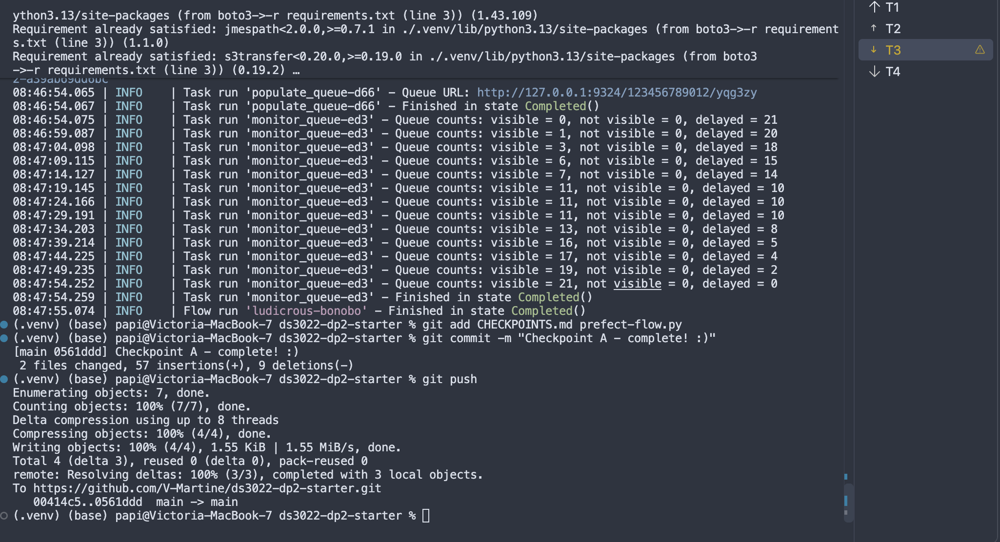
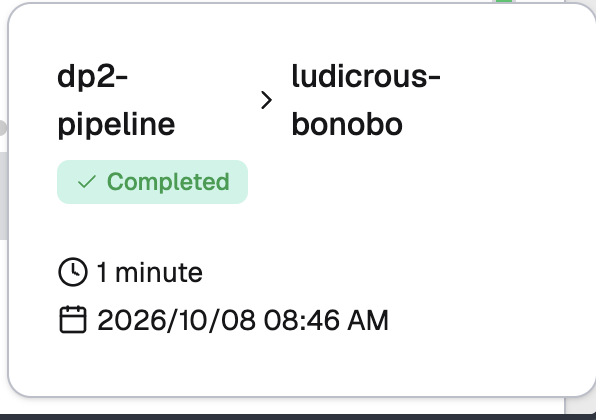
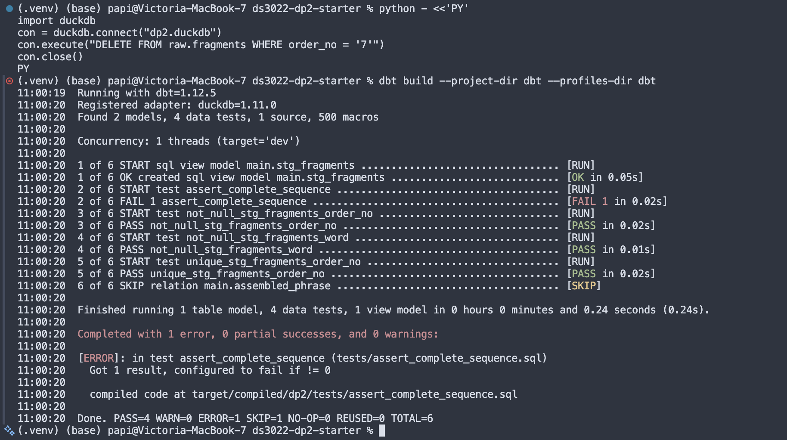
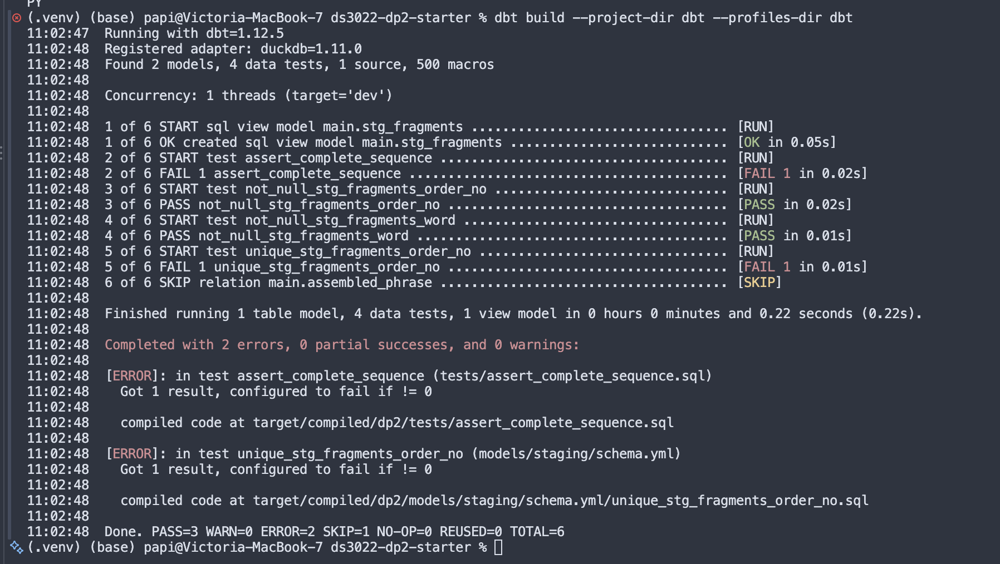
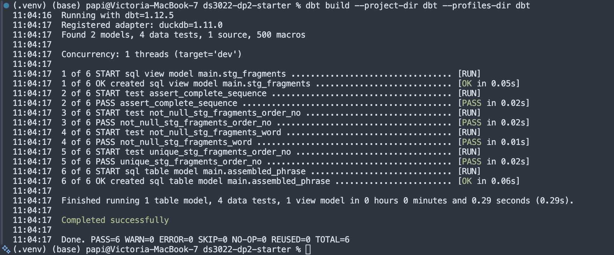
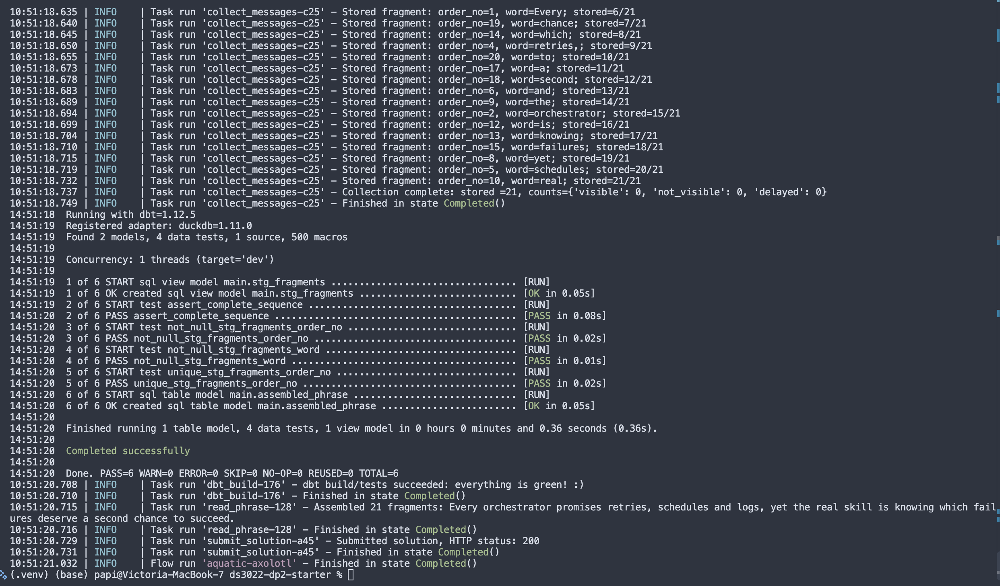
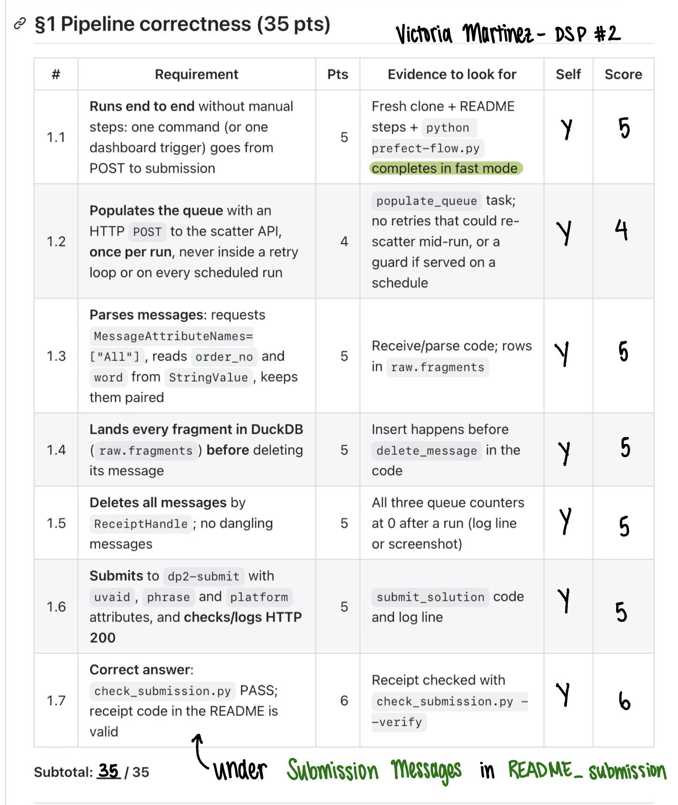
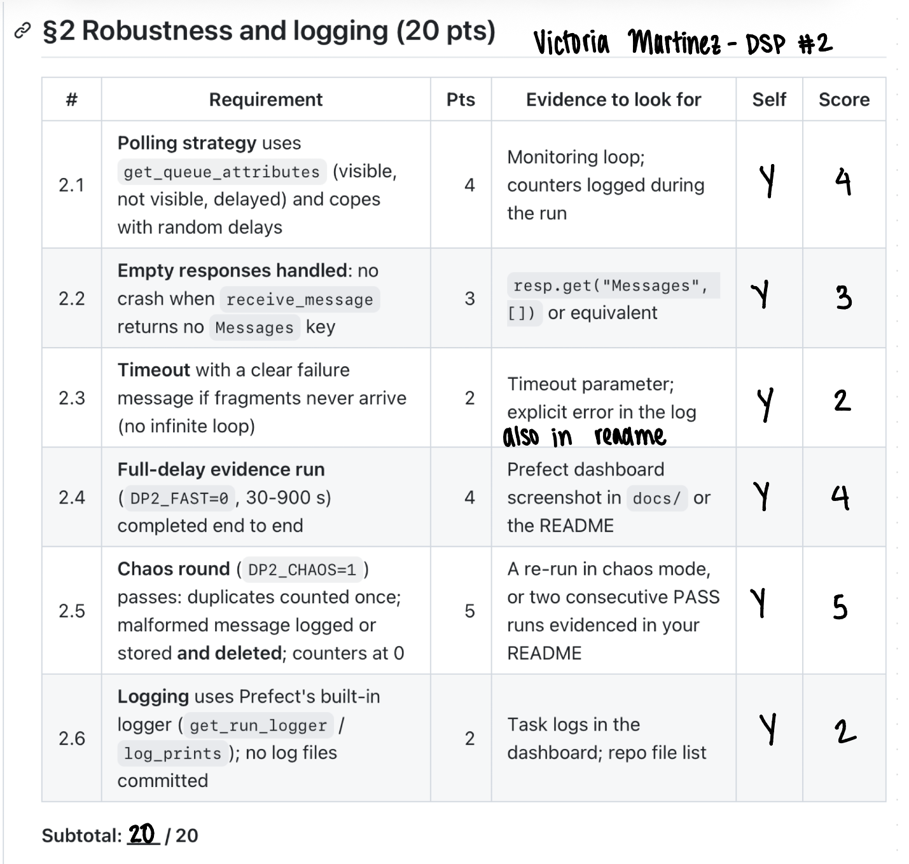
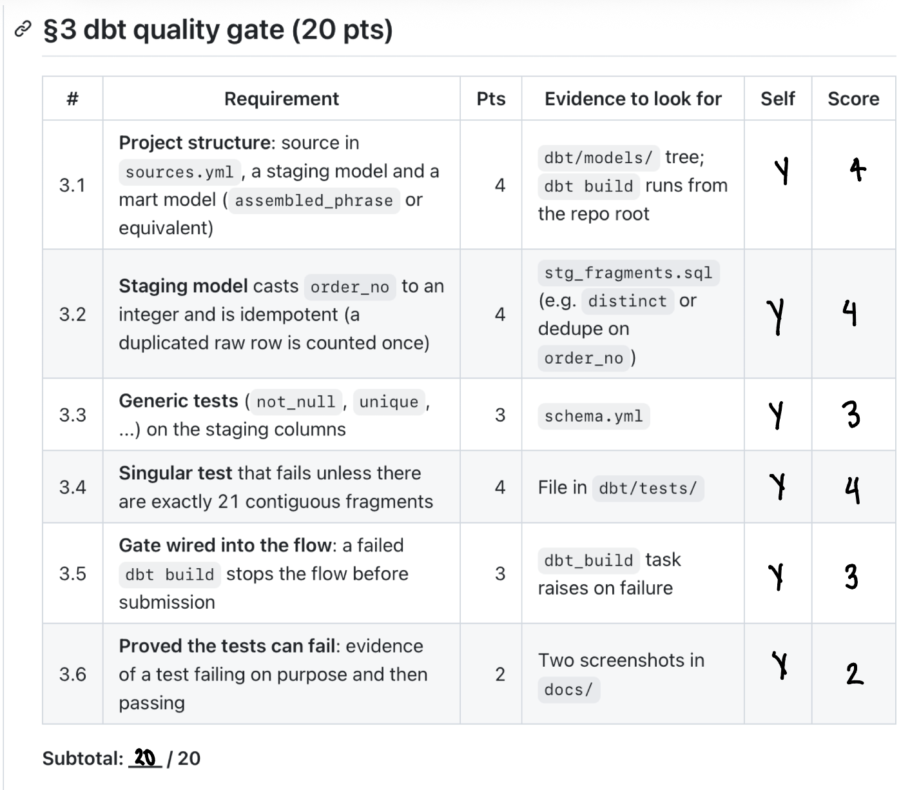
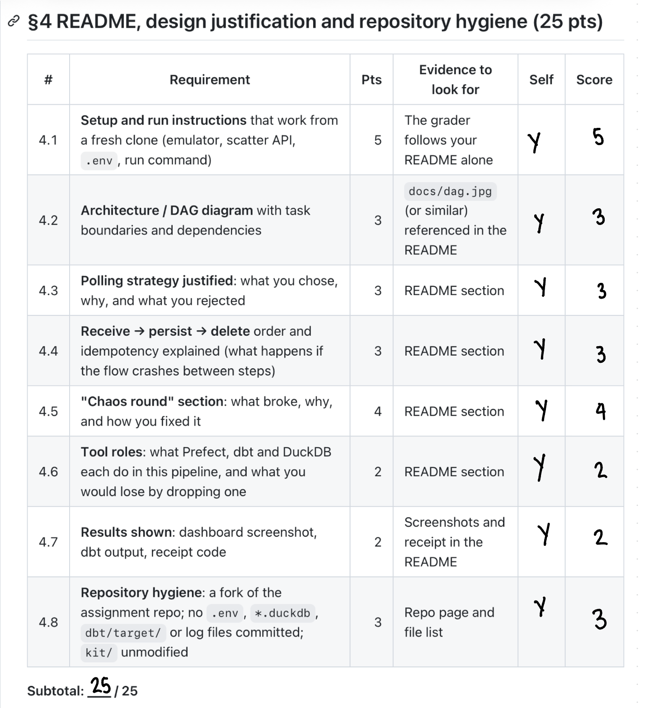

# DS 3022 - Project #2
### Victoria Martinez - October 19 - UVA id: yqg3zy 
### Submission README that explains my pipeline 

Prefect flow `dp2-pipeline` in prefect-flow.py populates my SQS queue, collects the 21 delayed fragements (differing in the length of the delay between messages), lands them in DuckDB (`raw_fragements`), runs `dbt build` as a quality gate and then submits the assembled phrase to "dp2-submit` only if dbt passes. 

My pipeline: 


```
populate_queue -> monitor_queue -> collect_messages -> dbt_build -> read_phrase -> submit_solution
```

## Setup and Run Instructions: 
1. Followed the SETUP.md to set up the venv and requirements: `python -m venv .venv && source .venv/bin/activate && pip install -r requirements.txt`
2. Set up the .env and added my `UVA_ID`
3. Followed the SETUP.md for the four terminals (SQS emulator, scatter API, Prefect server, working terminal: T1: `moto_server -p 9324`, 
T2: `python kit/scatter_api.py`, T3: `python kit/smoke_test.py`, and T4: `prefect config set PREFECT_API_URL="http://127.0.0.1:4200/api"
prefect server start`)
4. Made sure that `python kit/smoke_test.py` prints `Emulator OK`. 
5. Tested the submission from the **repo root**: `python prefect-flow.py`, then `python kit/check_submission.py`.

### Environment Variables: 
`UVA_ID`, `SCATTER_PORT` (default 8000), `DP2_DUCKDB` (default `dp2.duckdb`),
`DP2_FAST` (1 = 5-60 s delays, 0 = 30-900 s).

## My polling strategy: 
### Tasks in `prefect-flow.py` 
1. `monitor_queue`: polls every 5 secs and logs the visible/not visible/delayed messages. Includes both a countdown for progress and a timeout:`TimeoutError: Collection timed out: stored 0/21 fragments; queue counts={'visible': 0, 'not_visible': 0, 'delayed': 0} after 1200 seconds`
2. `collect_messages`: ensured that the target number to receive is 21 unique messages by cross-checking with the `counts.values`. Kept both a tracker for inserting and existing to ensure that all a duplicate message not stored twice and deletes the message from the queue to prevent anything reprocessing. 
3. `dbt_build`: runs a check for the dbt pipeline and returns the same tests as running dbt by hand. 
4. `read_phrase`: checks if a phrase exists in the `main.assembled_phrase` and reads it from the dbt mart model in DuckDB 
5. submit_solution: provides 2 retries in case it fails due to the wrong order or missing word. Returns the message attributes of UVA-ID, the phrase and the platform along with the HTTP status when submitting the solution. 


### Receive -> persist -> delete: 
For each of the messages: 
1. read `order_no` and `word` from `MessageAttributes` 
2. INSERT into `raw.fragements, and then 
3.`delete_message`. 

**What happens if the flow crashes between steps**: If the message crashes between the save/insert step and the delete step (steps 2 and 3), the message reappears after the visibility timeout and is a "repeat delivery". This means that the code skips the insert (same order_no and word) but still deletes it. But, if it crashes before the insert step, nothing is lost because the message is still on the queue. This ensures that a fragment is never deleted before it is safely stored. 
For example: INSERT EXAMPLE FROM SAME ORDER_NO

### **"Chaos round" Section:** 
1. What broke: For the first chaos run (`spicy-lorikeet`), I received: out-of-order messages (started with 18 and ended with 2), duplicate order_nos (15 and 16) and a malformed message. For the second run (`brawny-millipede`), I received: out-of-order messages (started with 11 and ended with 15), duplicate order_nos (7 and 21) and a malformed message. 
2. Why: duplicate orders are caused by the same fragment arriving twice whie poison messages are found when something like a "?" or "!" with no `word` attributes comes the pipeline. 
3. How I fixed it: to fix the duplicate orders, I had to deliver it but only count once, sending a message to the logger like `Task run 'collect_messages-f45' - Duplicate order_no=15; counted once` to make sure that it is received and handled properly. For the poison message that has no word attribute, I had to build in a store then delete process so that counters could finish the run properly. 

### Tool Roles: 
1. **Prefect:** Preforms the E and L part of the pipeline and coordinates the workflow so that all of the tasks run in order with logs of their runs. It makes sure to have quality checks by dbt complete during the pipeline to make sure that the data passing through is validated, clean and complete. Otherwise, a failure would derail the process or I would have to run and coordinate each step manually. 

2. **dbt:** acts as the quality check for the fragment data. For the uniqueness test: I added checks to ensure that both are non-null and that `order_no` is unique. If there is a match, both rows remain in staging and the uniqueness test fails. 
The `assert_complete_sequence` tests that the staging (1) contains 21 fragments, (2) starts at order 1, (3) ends at order 21 and (4) has no gaps. dbt then builds the `assembled_phrase` only when all of the tests pass. 

3. **DuckDB:** saves each message fragement in `raw.fragements` before de
leting that from the queue. If it didn't exist, or if the data was deleted at the wrong time, the fragments could be lost and I would have to collect them again. 

### dbt process and tests
__How my dbt tests protect the result:__ `stg_fragments` casts the order_no into an iteger and cleans up each row per fragment so that when the tests start (`schema.yml` and `assert_complete_sequence.sql`) the fragment can be checked for being the correct length, unique and doesn't have any gaps. If any test fails, dbt protects the phrase by skipping assembled_phrase and stopping the flow before read_phrase and submit_solution. This means that read and submit only occurs if all pass and prevents incomplete or inconsistent phrases being assembled. This means that the tests act like a quality gate, making sure that the data passing through is validated before it proceeds to the next step. 

## Evidence Screenshots: 
### Checkpoint A Screenshots: 
Working prefect flow and SET-UP done correctly: 




### Checkpoint C Screenshots:  
From slides: `dbt build --project-dir dbt --profiles-dir dbt` → FAIL on `assert_complete_sequence`, `assembled_phrase` SKIP
Screenshot: 


Second test: add (`7`, `oops`, current_timestamp) to a clean table: unique fails too. 
Screenshot: 


Third test: fixed and rerun to all green: 
Screenshot: 

### Full Evidence Run: 
For the full evidence run, the completion message/receipt code is below under "Submission Messages" and here is the dashboard screenshot: 



### Chaos Run: 


## Git-Ignore:
`.env`, `*.duckdb`, `dbt/target/` and logs are git-ignored.

`kit/` is unmodifed. 

## Submission Messages: 
Passing submission for FAST:
```
(.venv) (base) papi@Victoria-MacBook-7 ds3022-dp2-starter % python kit/check_submission.py
PASS  yqg3zy / prefect  receipt: 126A1DEA8F

1/1 submission(s) correct. Checked submissions were removed.
```

Passing submission for NORMAL: 
```
10:51:20.708 | INFO    | Task run 'dbt_build-176' - dbt build/tests succeeded: everything is green! :)
10:51:20.710 | INFO    | Task run 'dbt_build-176' - Finished in state Completed()
10:51:20.715 | INFO    | Task run 'read_phrase-128' - Assembled 21 fragments: Every orchestrator promises retries, schedules and logs, yet the real skill is knowing which failures deserve a second chance to succeed.
10:51:20.716 | INFO    | Task run 'read_phrase-128' - Finished in state Completed()
10:51:20.729 | INFO    | Task run 'submit_solution-a45' - Submitted solution, HTTP status: 200
10:51:20.731 | INFO    | Task run 'submit_solution-a45' - Finished in state Completed()
10:51:21.032 | INFO    | Flow run 'aquatic-axolotl' - Finished in state Completed()
(.venv) (base) papi@Victoria-MacBook-7 ds3022-dp2-starter % python kit/check_submission.py          
PASS  yqg3zy / prefect  receipt: 126A1DEA8F

1/1 submission(s) correct. Checked submissions were removed.
(.venv) (base) papi@Victoria-MacBook-7 ds3022-dp2-starter % 
```
Passing simulation for Chaos #1: 
```
12:47:46.461 | INFO    | Task run 'dbt_build-915' - dbt build/tests succeeded: everything is green! :)
12:47:46.463 | INFO    | Task run 'dbt_build-915' - Finished in state Completed()
12:47:46.466 | INFO    | Task run 'read_phrase-8e4' - Assembled 21 fragments: Every orchestrator promises retries, schedules and logs, yet the real skill is knowing which failures deserve a second chance to succeed.
12:47:46.468 | INFO    | Task run 'read_phrase-8e4' - Finished in state Completed()
12:47:46.479 | INFO    | Task run 'submit_solution-886' - Submitted solution, HTTP status: 200
12:47:46.480 | INFO    | Task run 'submit_solution-886' - Finished in state Completed()
12:47:47.501 | INFO    | Flow run 'spicy-lorikeet' - Finished in state Completed()
(.venv) (base) papi@Victoria-MacBook-7 ds3022-dp2-starter % python kit/check_submission.py
PASS  yqg3zy / prefect  receipt: 126A1DEA8F

1/1 submission(s) correct. Checked submissions were removed.
```

Passing simulation for Chaos #2: 
```
18:41:45  Done. PASS=6 WARN=0 ERROR=0 SKIP=0 NO-OP=0 REUSED=0 TOTAL=6
14:41:45.830 | INFO    | Task run 'dbt_build-f9c' - dbt build/tests succeeded: everything is green! :)
14:41:45.834 | INFO    | Task run 'dbt_build-f9c' - Finished in state Completed()
14:41:45.838 | INFO    | Task run 'read_phrase-7ba' - Assembled 21 fragments: Every orchestrator promises retries, schedules and logs, yet the real skill is knowing which failures deserve a second chance to succeed.
14:41:45.839 | INFO    | Task run 'read_phrase-7ba' - Finished in state Completed()
14:41:45.851 | INFO    | Task run 'submit_solution-f82' - Submitted solution, HTTP status: 200
14:41:45.853 | INFO    | Task run 'submit_solution-f82' - Finished in state Completed()
14:41:46.268 | INFO    | Flow run 'bold-ferret' - Finished in state Completed()
(.venv) (base) papi@Victoria-MacBook-7 ds3022-dp2-starter % python kit/check_submission.py
PASS  yqg3zy / prefect  receipt: 126A1DEA8F

1/1 submission(s) correct. Checked submissions were removed.
```

```
(.venv) (base) papi@Victoria-MacBook-7 ds3022-dp2-starter % python kit/check_submission.py --verify yqg3zy prefect 126A1DEA8F 
VALID receipt
```

## Rubric Pictures: 





